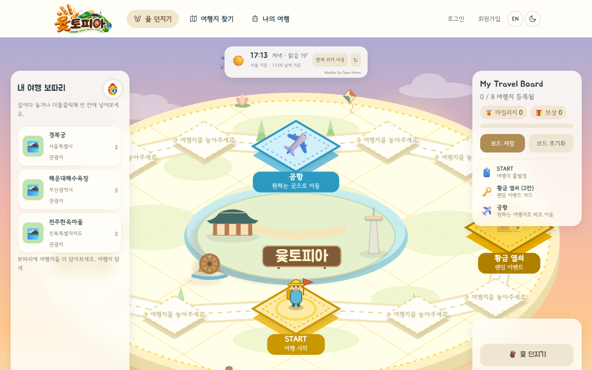
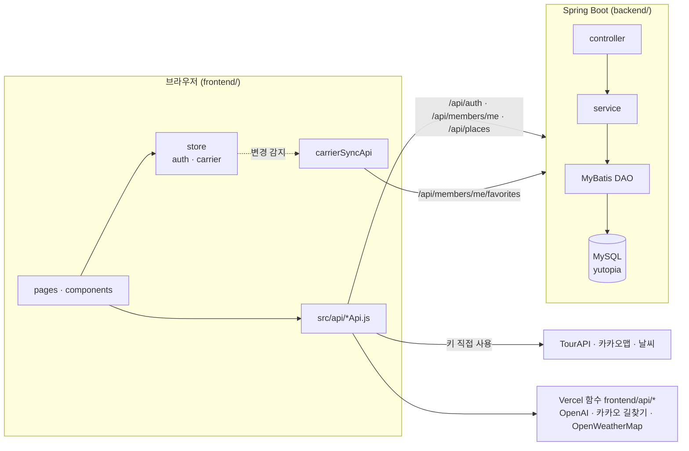

# 🪵 윷토피아 YUTOPIA

> **윷을 던지며 떠나는 나만의 국내 여행 보드게임**
> 여행지를 보따리에 담고 → 윷판에 올리고 → 윷을 던져 한 칸씩 여행합니다.

SSAFY 관통 프로젝트 6팀 · **Vanilla JS + Vite** 프론트엔드 + **Spring Boot + MyBatis** 백엔드

🔗 배포(프론트): **[yutopia-web.vercel.app](https://yutopia-web.vercel.app/#/board)**



<br>

## 🏗 아키텍처



| 영역 | 담당 |
| --- | --- |
| **frontend** | 화면, 윷판 게임, 알고리즘(TSP·날씨 점수화·맞춤 추천), 외부 API, 서버 키를 숨기는 서버리스 함수 |
| **backend** | 회원·인증(PBKDF2 + HMAC 토큰), 보따리(찜) 저장, DB에 적재한 여행지 조회 REST API |

프론트는 `VITE_API_BASE_URL`이 있으면 백엔드에 연결하고, 없으면 브라우저 목업(localStorage)으로 단독 실행돼요.

<br>

## 🚀 한 번에 실행하기

**필요한 것**: Node 20+, Java 21+, MySQL 8.0.16+

```bash
# 1) DB 만들기 + 샘플 데이터 (서울·부산·제주 관광지 30곳)
cd backend
mysql -u ssafy -p --default-character-set=utf8mb4 < src/main/resources/db/schema.sql
mysql -u ssafy -p --default-character-set=utf8mb4 yutopia < src/main/resources/db/seed.sql

# 2) 백엔드 실행 → http://localhost:8080
./mvnw spring-boot:run            # Windows: .\mvnw.cmd spring-boot:run

# 3) 프론트 실행 → http://localhost:5173
cd ../frontend
npm install
cp .env.example .env.local        # VITE_API_BASE_URL=http://localhost:8080
npm run dev
```

> DB 계정 기본값은 `ssafy / ssafy`예요. 다른 계정은 환경변수 `YUTOPIA_DB_USERNAME`, `YUTOPIA_DB_PASSWORD`로 지정해요. ⚠ `schema.sql`은 기존 `yutopia` DB를 지우고 새로 만들어요.

<br>

## 📁 저장소 구조

```
yutopia/
├─ frontend/                 Vanilla JS + Vite
│  ├─ api/                   Vercel 서버리스 함수 (서버 전용 키)
│  ├─ src/
│  │  ├─ algorithm/          TSP · 날씨 정책 · recommendation/(맞춤 윷판 추천)
│  │  ├─ api/                외부·백엔드 통신 (+ mock/ 목업)
│  │  ├─ pages/ components/ store/ router/ i18n/ styles/ utils/
│  ├─ tests/                 node --test
│  └─ docs/                  설계 문서 · 스크린샷
├─ backend/                  Spring Boot 4 + MyBatis
│  ├─ src/main/java/com/yutopia/
│  │  ├─ controller/         REST API (+ dto/)
│  │  ├─ service/            비즈니스 로직 · 검증
│  │  ├─ model/dao, dto/     MyBatis DAO · DB 엔티티
│  │  ├─ security/           비밀번호 해시 · 토큰 · 인증 인터셉터
│  │  ├─ config/ exception/  CORS·인터셉터 등록 · 공통 오류 응답
│  ├─ src/main/resources/    mappers/ · db/(schema·seed)
│  └─ scripts/               테스트 DB 준비 · TourAPI 수집 (Python)
└─ .github/workflows/ci.yml  프론트 lint·test·build / 백엔드 MySQL 통합 테스트
```

## 📚 상세 문서

- **[frontend/README.md](frontend/README.md)**: 기능, 적용 알고리즘 3개, 화면, 환경변수
- **[backend/README.md](backend/README.md)**: REST API 명세, DB, 테스트

## ✅ 검증

| 대상 | 명령 | 결과 |
| --- | --- | --- |
| 프론트 | `npm run lint && npm test && npm run build` | 단위 테스트 68/68 (유토 14개 포함) |
| 백엔드 | `./mvnw test` (실제 MySQL `yutopia_test`) | DAO 60 + API 흐름 4 + 컨텍스트 1 = **65/65** |
