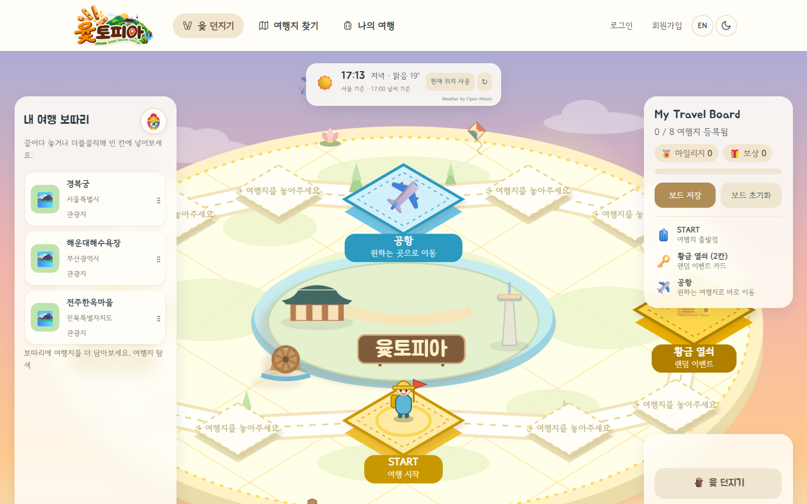
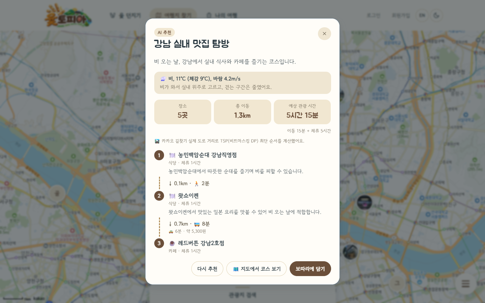
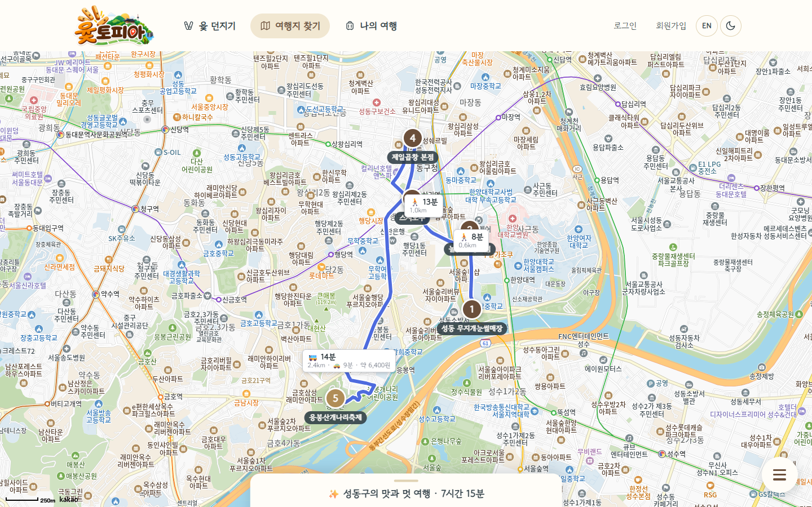
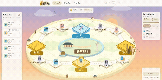
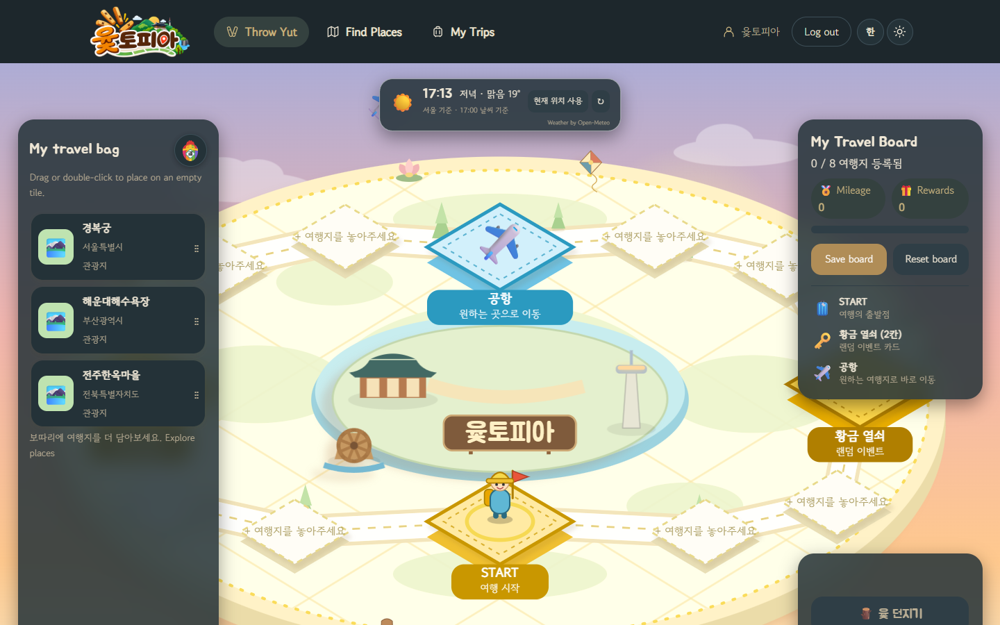
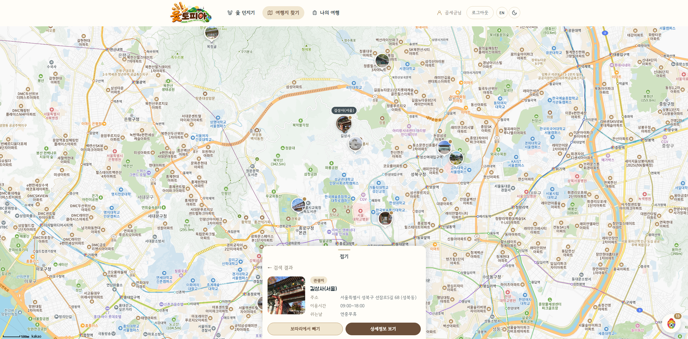
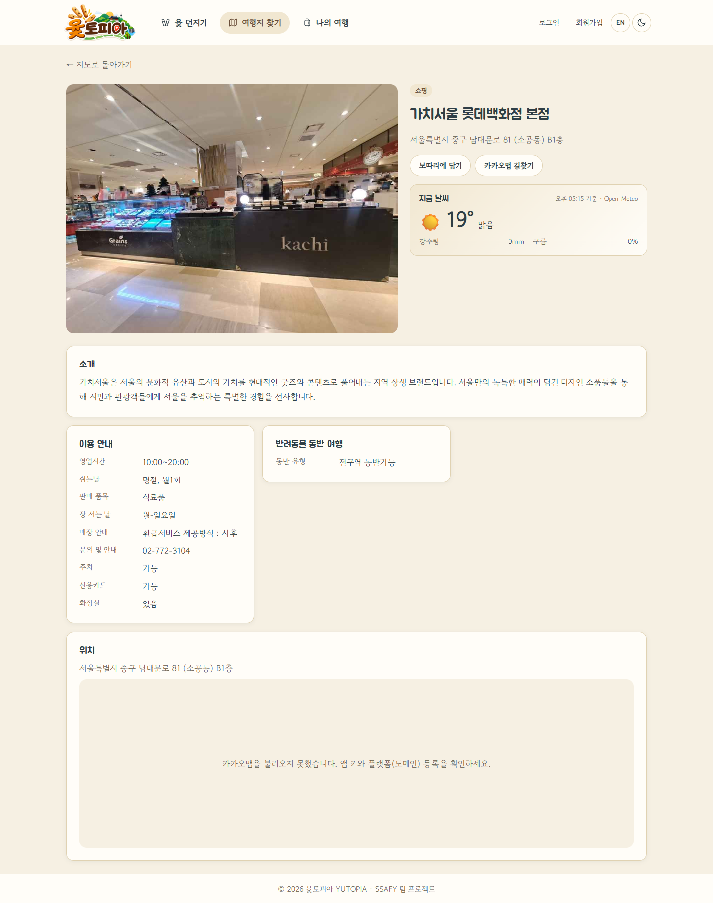
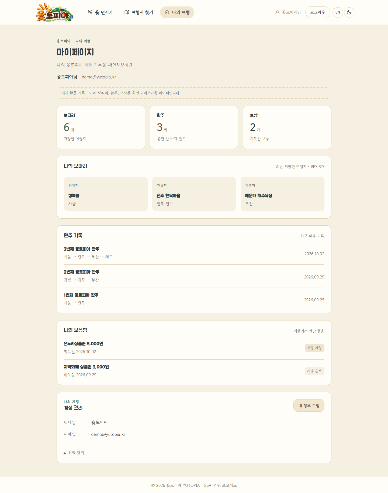

# 🪵 윷토피아 YUTOPIA — Frontend

> **윷을 던지며 떠나는 나만의 국내 여행 보드게임**
> 여행지를 보따리에 담고 → 윷판에 올리고 → 윷을 던져 한 칸씩 여행합니다.

한국관광공사 **TourAPI**, **기상청/OpenWeatherMap**, **카카오맵**을 엮은 놀이형 여행 계획 서비스입니다.
SSAFY 관통 프로젝트 6팀 · **Vanilla JS + Vite** · Algorithm PJT(4회차) 적용

### 🔗 배포: **[yutopia-web.vercel.app](https://yutopia-web.vercel.app/#/board)**



<br>

## ✨ 주요 기능

| 기능 | 설명 |
| --- | --- |
| 🗺️ 여행지 찾기 | 이름·지역 검색 → 지도에 **사진 핀**, 누르면 요약 카드 |
| 📄 상세 정보 | 사진, 소개, 이용 안내, 반려동물 정보, **현재 날씨**, 길찾기 |
| 🧳 보따리 | 여행지 담기 + 메모, 브라우저에 저장되어 윷판으로 연결 |
| 🎲 윷판 | 보따리 여행지 8칸 배치 → 윷 던지기. 황금 열쇠·공항 순간이동, 보상·마일리지 |
| 🎯 맞춤 윷판 추천 | 취향·거리·날씨·다양성으로 8곳 조합 추천 (알고리즘 #1) |
| 🤖 AI 코스 추천 | 날씨로 후보 선택 + **TSP**로 최단 방문 순서, 실제 도로 경로 표시 (알고리즘 #2, #3) |
| 💬 유토 | 추천 결과와 지도 코스에서 코스별 대화, 도보 시간·경로 주변 장소·경유 시간 안내 (Spring AI 백엔드 연결·로그인 필요) |
| 👤 회원 | 가입·로그인·비밀번호 찾기·정보 수정·탈퇴·마이페이지 (백엔드 연결 시 서버 인증, 아니면 PBKDF2 목업) |
| ☁️ 보따리 동기화 | 로그인하면 보따리가 서버 찜과 자동 동기화 (기기 간 유지) |
| 🌗 / 🌐 / 📱 | 다크 모드 · 한국어/English · `rem` 기반 반응형 |

<br>

## 💬 추천 코스와 대화하는 유토

AI 코스 추천 결과가 나오면 오른쪽 아래 **유토** 버튼으로 대화를 엽니다. ‘지도에서 코스 보기’로 이동해도 같은 코스의 대화가 이어집니다. 코스 변경·닫기·페이지 이동 시 해당 UI와 요청을 정리하며, 다른 로그인 계정에는 이력을 전달하지 않습니다. 로그인 화면으로 이동할 때는 선택 코스만 메모리에 보관하여 지도로 돌아오면 복원합니다. 새로고침을 넘는 복원이나 채팅의 브라우저 저장은 하지 않습니다.

- 질문 예: “첫 번째에서 두 번째 장소까지 걸어서 얼마나 걸려?”, “가는 길에 음식점/경찰서 있어?”, “이 식당을 들르면 얼마나 더 걸려?”
- 현재 방문 순서와 장소 좌표만 대화 생성 API에 전달합니다. 장소의 내부 ID는 화면에 표시하지 않습니다.
- 답변은 일반 텍스트로 안전하게 표시하고, 실제 조회 근거와 카카오 장소 링크를 함께 표시합니다. 예상 이동 시간과 체류 시간의 계산은 백엔드 Tool을 사용합니다.
- 응답 대기 중 중복 전송을 막습니다. 통신 실패로 완료 여부가 불명확하면 **답변 상태 확인**으로 서버 이력을 읽은 뒤 다시 질문하도록 하며 같은 질문을 자동 재전송하지 않습니다.
- 새 대화는 확인 후 기존 대화를 삭제합니다. 404 만료 시 새로 시작할 수 있고, 인증 만료 시 다시 로그인하도록 안내합니다. 패널 닫기·Escape는 대화를 지우지 않습니다.

### 연결 조건

`frontend/.env`의 `VITE_API_BASE_URL`을 백엔드 주소로 지정하고 `VITE_USE_MOCK=false`로 설정합니다. 백엔드는 `ai` 프로필, OpenAI·TMAP·카카오 REST 키와 실제 회원 로그인이 필요합니다. 키는 백엔드 `.env`에만 설정합니다. 백엔드 미설정·목업 모드에서는 가짜 AI 답변을 생성하지 않고 이용 불가 안내를 표시합니다. 기존 코스 추천·지도·보따리 동작은 그대로 사용합니다.

서버 API는 [백엔드 README](../backend/README.md)의 유토 5단계를 참고하세요. 현재 코스 추천 자체는 기존 Vercel 경로를 사용하고, **유토 대화가 Spring AI 백엔드로 연결**됩니다.

### 검증

`npm run lint`, `npm test`(기존 54개 + 유토 14개 = **68개**), `npm run build`를 확인했습니다. 추가 테스트는 이력 재사용, 코스 변환, 중복 전송, 계정 전환/로그아웃 중 늦은 응답, 요청 취소, 불명확한 전송 결과의 복구, 만료·새 대화, 텍스트/링크 이스케이프를 검증합니다. 다른 탭의 로그인 정보 변경도 감지하며 HTTP 요청과 같은 저장소의 인증 정보를 사용합니다.

외부 API 없이 별도의 예시 데이터와 headless Chrome으로 실제 추천 모달 → 채팅 폼 → 지도 위젯 대화 유지, 모바일 범위·다크 모드·한글 입력 조합·새 대화·로그아웃 UI를 확인했습니다. 브라우저 검증의 답변·지도 배경은 예시이며 실제 서버·지도·LLM 연동 검증은 남아 있습니다.

## 🧮 적용 알고리즘

| # | 알고리즘 | 적용 위치 | 시간 복잡도 |
| --- | --- | --- | --- |
| 1 | 콘텐츠 기반 필터링 + 가중치 점수화 + 다중 시작점 탐욕/지역 탐색 | 맞춤 윷판 8곳 추천 | O(n² + S²·n + (S+P)·n·k³) |
| 2 | **TSP 비트마스킹 DP (Held–Karp)** + Haversine | AI 코스 방문 순서 (도로 거리 최단) | O(2ⁿ·n²) |
| 3 | **날씨 규칙 기반 점수화 + Top-K 선택** | 실내/야외 장소 선택, 도보 한계 거리 | O(n log n) |
| + | PBKDF2-HMAC-SHA256 (600,000회, 16B salt) | 목업 회원 비밀번호 해싱 | O(반복 횟수) |

### AI 코스 추천 파이프라인

```
지역 + 카테고리
 ─▶ ① 카카오 로컬 검색: 반경 2km 후보 수집
 ─▶ ② 현재 날씨 → 야외 적합도 · 걷는 한계          ← #3
 ─▶ ③ 날씨 점수 정렬, 카테고리별 Top-K만 AI에 전달  ← #3
 ─▶ ④ OpenAI: 코스에 넣을 장소·체류 시간·이유 선택
 ─▶ ⑤ 카카오모빌리티: 장소 간 도로 거리 n×n 행렬
 ─▶ ⑥ TSP 비트마스킹 DP: 최단 방문 순서             ← #2
 ─▶ ⑦ 구간별 도로 경로 + 이동 시간/택시 요금 표시
```

> **AI는 "무엇을", 알고리즘은 "어떤 순서로"** — 순서를 LLM에 맡기면 매번 달라지고 최단 보장이 없습니다. AI·길찾기·날씨 중 무엇이 실패해도 대체값으로 코스가 만들어집니다.

| 날씨 반영 결과 | 도로 경로 + 구간 시간 |
| --- | --- |
|  |  |

<br>

### #1 맞춤 윷판 추천

- 보따리·윷판에 **실제로 담은** 여행지의 유형·지역·태그로 취향 추정
- 점수 = 거리 30% + 취향 35% + 날씨 20% + 다양성(MMR) 15%
- 최대 10개 시작점 탐욕 선택 → 최대 2회 교체 탐색으로 8곳 조합 개선 (근사 최적화)
- 기존 배치 유지 보너스(최대 10점), 합산 차이 5점 이내면 기존 유지 우선
- 상세: [docs/BOARD_RECOMMENDATION.md](docs/BOARD_RECOMMENDATION.md)

### #2 TSP 비트마스킹 DP

| 항목 | 정의 |
| --- | --- |
| 상태 | `dp[mask][i]` = `mask`를 모두 방문하고 `i`에 있을 때 최소 거리 |
| 점화식 | `dp[mask \| (1<<j)][j] = min(dp[mask][i] + dist[i][j])` |
| 정답 | `min_i dp[(1<<n)-1][i]`, `parent`로 경로 복원 |

여행 코스용 변형: **열린 경로**(복귀 X) · **도착지 고정**(숙소를 마지막에) · **비대칭 거리**(일방통행) 지원.
`dp`는 `Float64Array(2ⁿ·n)`, `parent`는 `Int8Array`로 평탄화. `MAX_TSP_NODES = 12`.

| n | 완전탐색 | 비트마스킹 DP | 상태 수 |
| --: | --: | --: | --: |
| 8 | 5.9ms | 0.3ms | 2,048 |
| 10 | 124.1ms | 0.3ms | 10,240 |
| 12 | 측정 생략 | 1.4ms | 49,152 |

- n=10에서 **약 400배** 빠름
- 탐욕(Nearest Neighbor)은 300회 중 **32%에서 최적 실패**, 최악 +17.3% → DP는 300/300 최적
- 한계: 실제 입력은 최대 7곳이라 규모가 작음 / 병목은 DP(1ms)가 아니라 길찾기 API 호출 → `Promise.all` 병렬화 + 실패 시 직선거리×1.3 대체

### #3 날씨 기반 코스 추천

| 우선 | 조건 | 야외 적합도 | 걷는 한계 |
| --: | --- | --: | --: |
| 1~3 | 천둥번개 / 비 / 눈 | 10 / 20 / 25 | 0.4km |
| 4~5 | 체감 33℃↑·−5℃↓ / 강풍 10m/s↑ | 25 / 35 | 0.6km |
| 6 | 안개 | 55 | 0.9km |
| 7~8 | 흐림·구름 / 맑음 | 72·85 / 95 | 1.2km |

```
날씨 적합도 = 야외: 야외 적합도 | 실내: 60 + (100 − 야외 적합도) × 0.4 | 중립: 60
최종 점수   = 0.6 × 날씨 적합도 + 0.4 × 가까움(2km 기준)
```

정렬 후 관광명소는 맑으면 2곳 / 궂으면 1곳, 선택 카테고리는 1곳씩. 같은 0.8km 구간도 맑으면 🚶 도보, 비 오면 🚌/🚕로 바뀝니다.

### 코드 위치

| 알고리즘 | 구현 | 테스트 |
| --- | --- | --- |
| TSP · 이동 수단 분류 | [src/algorithm/tsp.js](src/algorithm/tsp.js) | [tests/tsp.test.js](tests/tsp.test.js) |
| 날씨 점수화 · Top-K | [src/algorithm/weatherPolicy.js](src/algorithm/weatherPolicy.js) | [tests/weatherPolicy.test.js](tests/weatherPolicy.test.js) |
| 코스 추천 전체 흐름 | [src/api/aiCourse.js](src/api/aiCourse.js) | — |
| 맞춤 윷판 추천 | [src/algorithm/recommendation/](src/algorithm/recommendation/) | [tests/recommendation.test.js](tests/recommendation.test.js) |
| PBKDF2 해싱 | [src/api/mock/mockMembers.js](src/api/mock/mockMembers.js) | [tests/mockMembers.test.js](tests/mockMembers.test.js) |
| 서버 함수 (키 보호) | [api/](api/) | — |
| 성능 측정 | [scripts/benchmark-tsp.js](scripts/benchmark-tsp.js) | — |

<br>

## 📸 화면

| 윷판 플레이 | 다크 · English |
| --- | --- |
|  |  |

| 여행지 찾기 | 여행지 상세 | 마이페이지 |
| --- | --- | --- |
|  |  |  |

<br>

## 🧭 페이지 · 구조

| 경로 | 페이지 | 파일 |
| --- | --- | --- |
| `#/board` | 윷판 | `src/pages/BoardPage.js`, `src/pages/board/*` |
| `#/map` | 여행지 찾기 | `src/pages/MapPage.js` |
| `#/map/details/:id` | 여행지 상세 | `src/pages/PlaceDetailPage.js` |
| `#/mypage` · `#/mypage/edit` | 마이페이지 · 정보 수정 | `src/pages/MyPage.js`, `MemberEditPage.js` |
| `#/login` · `#/signup` · `#/forgot-password` | 인증 | `src/pages/LoginPage.js` 외 |

```
frontend/
├─ api/            # Vercel 서버리스 함수 (OpenAI · 카카오 길찾기 · 날씨) — 서버 전용 키 사용
├─ src/
│  ├─ algorithm/   # 순수 함수: tsp.js, weatherPolicy.js, recommendation/(맞춤 윷판 추천)
│  ├─ api/         # 통신 레이어: TourAPI · 날씨 · 카카오맵 · 회원/인증 · 보따리 동기화
│  │  └─ mock/     # 백엔드·키 없이 동작하는 목업
│  ├─ components/  # Header, Footer, 보따리 위젯, AI 코스 모달, WeatherScene
│  ├─ pages/       # 라우트별 페이지 (board/ = 윷판 모듈)
│  ├─ router/ store/ i18n/ styles/ utils/
├─ tests/          # node --test 단위 테스트
├─ scripts/        # 벤치마크 · 점검 스크립트
└─ docs/           # 설계 문서 · 스크린샷
```

**기술 스택**: Vanilla JS(ES Modules) + Vite, 해시 라우터 + 자체 pub-sub 스토어, CSS 커스텀 프로퍼티 디자인 토큰, `t('한국어 키')` 방식 i18n

<br>

## 🔌 백엔드 연결

`VITE_API_BASE_URL`(예: `http://localhost:8080`)을 설정하면 [backend](../backend/README.md)와 실제로 연결돼요. 비워 두면 지금처럼 브라우저 목업으로만 동작해요.

| 기능 | 백엔드 연결 시 | 미연결 시 |
| --- | --- | --- |
| 회원·로그인·비밀번호 재설정 (`authApi`, `memberApi`) | `/api/auth/*`, `/api/members/me` | localStorage 목업 |
| 보따리 (`carrierSyncApi`) | 로그인하면 서버 찜과 합친 뒤 담기·빼기·메모를 자동 반영 | localStorage만 사용 |
| 여행지 검색·상세·맞춤 추천 후보 (`tourApi`) | TourAPI 키가 없으면 `/api/places`, `/api/areas` | TourAPI 키 → 목업 |

- 화면 코드는 바꾸지 않았어요. 각 `*Api.js`가 출처를 고르고, 보따리는 스토어 변경을 감지해서 서버에 반영해요(로컬 우선).
- 서버 오류 문구(`{"message"}`)는 그대로 화면에 나와요. 토큰이 만료(401)되면 자동으로 로그아웃돼요.

## 🚀 시작하기

```bash
npm install
cp .env.example .env.local   # 백엔드 없이 쓰려면 VITE_API_BASE_URL 을 비우세요
npm run dev
```

| 환경 변수 | 용도 | 브라우저 노출 |
| --- | --- | :---: |
| `VITE_USE_MOCK` / `VITE_WEATHER_USE_MOCK` | 여행지 / 날씨를 강제로 목업 사용 | ○ |
| `VITE_API_SERVICE_KEY` | 공공데이터포털 서비스키 (TourAPI) | ○ |
| `VITE_API_BASE_URL` | Spring 백엔드 주소 (`http://localhost:8080`) | ○ |
| `VITE_KAKAO_MAP_KEY` | 카카오맵 JavaScript 키 | ○ (도메인 등록) |
| `KAKAO_REST_API_KEY` | 카카오모빌리티 길찾기 | **✕ 서버 전용** |
| `WEATHER_KEY` | OpenWeatherMap | **✕ 서버 전용** |
| `OPENAI_API_KEY` / `OPENAI_MODEL` | AI 코스 추천 (기본 `gpt-4o-mini`) | **✕ 서버 전용** |

> 로컬에서는 `npm run dev`가 `api/*`를 `/api/*`로 제공합니다. Vercel 배포 시 위 변수를 Environment Variables에 넣고 Redeploy, 카카오 개발자 콘솔에 배포 도메인을 등록하세요.

### 커밋 전 체크

```bash
npm run format && npm run lint && npm run build && npm test
node scripts/benchmark-tsp.js    # (선택) TSP 성능·정확도 비교
```

<br>

## 📚 문서

- [AGENT.md](AGENT.md) — 전체 구조 · 컨벤션
- [docs/REQUIREMENTS_RFP.md](docs/REQUIREMENTS_RFP.md) — 관통 프로젝트 요구사항
- [docs/BOARD_RECOMMENDATION.md](docs/BOARD_RECOMMENDATION.md) — 맞춤 윷판 추천 상세
- [docs/workflows/](docs/workflows/) — 폴더별 작업 순서
- [docs/BRANCH_STRATEGY.md](docs/BRANCH_STRATEGY.md) — 브랜치 · 코드 스타일 규칙
